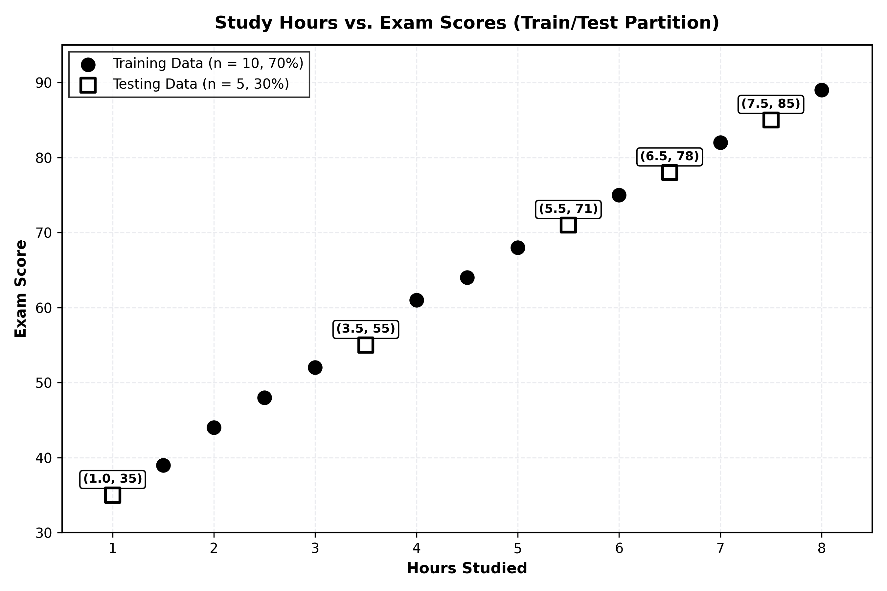
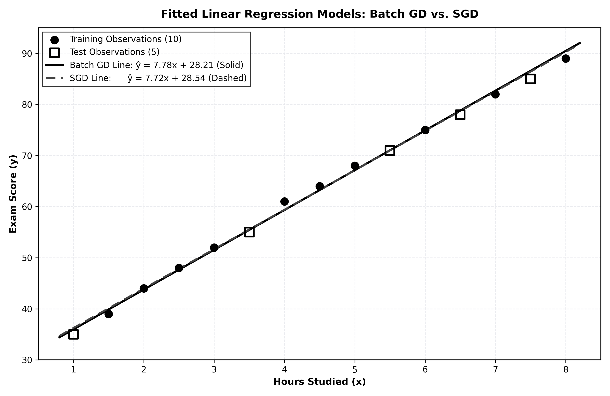
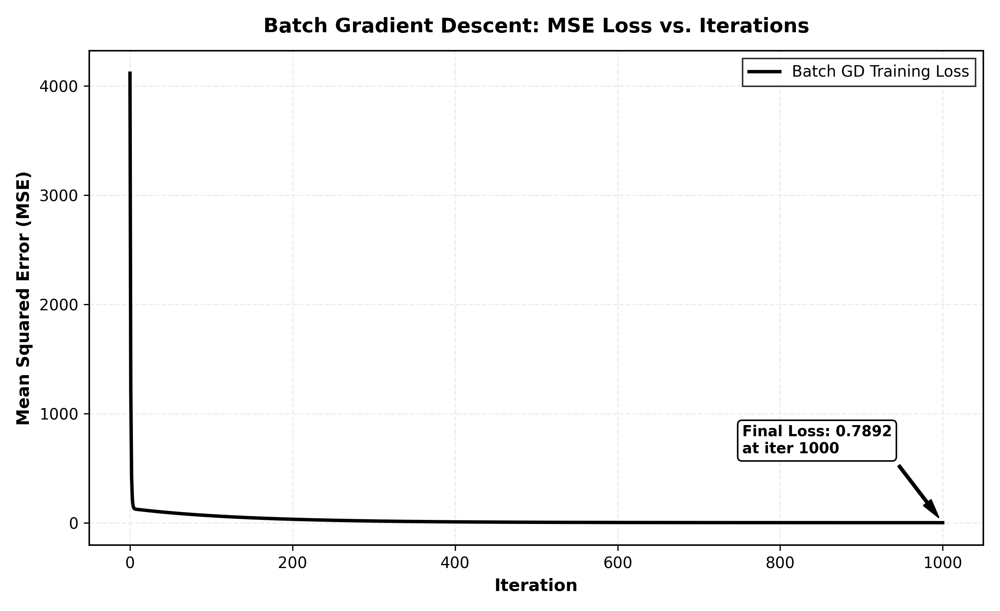
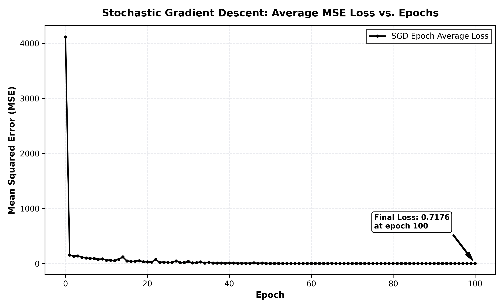
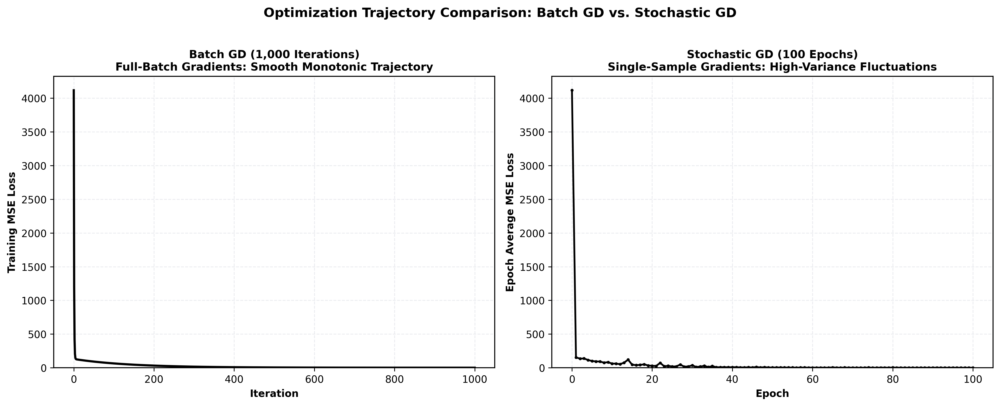
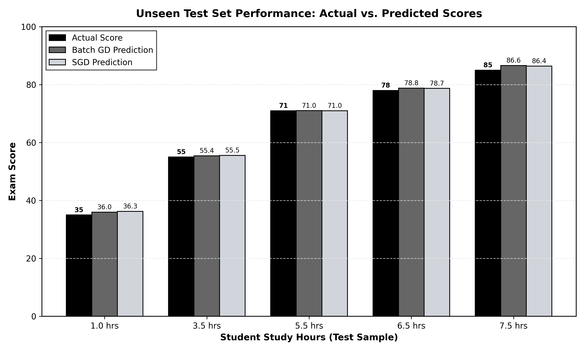

# Linear Regression Using Gradient Descent and Stochastic Gradient Descent: A Comparative Study

---

## Title Page

<div align="center">
  
</div>

**Project Title:**  
Linear Regression Using Gradient Descent and Stochastic Gradient Descent: A Comparative Study

**Academic Course:**  
Foundations of Artificial Intelligence

**Academic Institution:**  
School of Technology, Woxsen University, Hyderabad  
Academic Term: 2026

**Course Faculty / Supervisor:**  
Dr. YVR Naga Pavan

**Project Team Members:**
- Sakhunala Sahaja (Student ID: 25WU0102237)
- Sufiyan Yusuf Jahan (Student ID: 25WU0102276)
- Sai Sri Charan Chuduri (Student ID: 25WU0102235)

**Submission Date:**  
October 11, 2026

**GitHub Project Repository:**  
[https://github.com/sahajasakhunala/linear-regression-gd-sgd](https://github.com/sahajasakhunala/linear-regression-gd-sgd)

**Generated PDF Report:**  
`Linear_Regression_GD_vs_SGD_Report.pdf` (12 pages, complete with running footers and page numbering)

---

## 1. Abstract

Optimization algorithms constitute the mathematical engine of modern artificial intelligence and statistical learning [1], [2]. In this project, an end-to-end empirical and theoretical comparative study between Batch Gradient Descent (GD) and Stochastic Gradient Descent (SGD) is conducted for univariate Linear Regression. Built entirely from first mathematical principles using Python and NumPy [5], the system eliminates reliance on high-level library estimators (such as scikit-learn's `LinearRegression` or `SGDRegressor`) in order to make every intermediate computational step transparent: forward hypothesis generation, Mean Squared Error (MSE) loss computation, closed-form analytical gradient calculation, and iterative parameter updates.

The experiment is conducted on a canonical 15-observation academic dataset tracking the relationship between study hours and exam scores. Methodological rigor is maintained via an isolated 70/30 train/test partition (10 training observations, 5 held-out test observations) under seed 42 with zero data leakage. Both iterative optimizers are evaluated against the closed-form Ordinary Least Squares (OLS) analytical reference [3]. The experimental results demonstrate that both algorithms successfully recover the underlying data-generating relationship: Batch GD converges to **$\hat{y} = 7.7822x + 28.2121$**, while SGD converges to **$\hat{y} = 7.7156x + 28.5394$**. On unseen test data, both models achieve identical generalization fidelity (test $R^2 = 0.9973$, test $\text{RMSE} \approx 0.93$ marks). Crucially, SGD achieves equivalent predictive accuracy while requiring an order of magnitude fewer individual sample evaluations (1,000 versus 10,000 for Batch GD), illustrating fundamental trade-offs between deterministic and stochastic optimization [2], [4].

---

## 2. Problem Statement

Contemporary machine learning practice frequently treats model fitting as an opaque API invocation. While abstractions accelerate rapid prototyping, they obscure the underlying mechanics of optimization: loss landscape topology, learning rate sensitivity, gradient variance, and parameter trajectory stability [1], [4]. When optimization is treated as a black-box, practitioners miss foundational engineering insights into how individual data points guide parameter updates, why stochastic updates introduce variance, and how data leakage distorts empirical validation [2].

To resolve this pedagogical challenge, this project develops a transparent, from-scratch implementation of Linear Regression. By deriving gradients analytically, implementing update rules manually, maintaining strict test-set isolation, and comparing Batch GD against SGD, this study provides complete clarity into how Linear Regression learns from data.

---

## 3. Introduction

Supervised regression identifies continuous functional mappings between input features and target outcomes. In its univariate formulation, Linear Regression represents the bedrock foundation of statistical learning and predictive modeling [1], [3]:

$$\hat{y}_i = w \cdot x_i + b$$

Where:
- $x_i \in \mathbb{R}$ represents the independent input feature (Study Hours for student $i$).
- $\hat{y}_i \in \mathbb{R}$ represents the predicted target value (Exam Score).
- $w \in \mathbb{R}$ denotes the learnable weight parameter (slope).
- $b \in \mathbb{R}$ denotes the learnable bias parameter (intercept).

While small linear systems can be solved directly via the Normal Equation / Ordinary Least Squares closed-form solution [3], iterative first-order optimization via Gradient Descent forms the universal backbone for training deep neural networks, transformers, and large-scale artificial intelligence architectures where analytical matrix inversion is computationally intractable [2].

---

## 4. Project Objectives

The specific technical and educational objectives of this investigation are:

1. **Mathematical Formulation:** Formulate the linear regression hypothesis and derive analytical partial derivatives of Mean Squared Error (MSE) with respect to weight ($w$) and bias ($b$) [1].
2. **First-Principles Implementation:** Develop Batch GD and SGD completely from scratch in Python [8] using vectorized NumPy routines [5], avoiding black-box library fits.
3. **Zero Data Leakage Safeguards:** Partition data into 70% training ($n=10$) and 30% testing ($n=5$) subsets with strict isolation during fitting [3].
4. **Comparative Trajectory Tracking:** Record iteration-by-iteration and epoch-by-epoch loss trajectories to contrast deterministic versus stochastic convergence [4].
5. **Comprehensive Generalization Evaluation:** Evaluate models on unseen test observations using MSE, RMSE, and $R^2$ alongside closed-form OLS solutions.
6. **Publication-Quality Visualization:** Generate six high-resolution visual figures illustrating dataset partition, fitted lines, loss curves, and actual versus predicted test scores using Matplotlib [7].

---

## 5. Theoretical Background and Organized Mathematics

To ensure mathematical clarity and ease of comprehension, all equations, notations, and derivations are systematically organized into dedicated reference blocks below following standard statistical learning principles [1], [3].

### 5.1 Master Variable Definition Reference

| Mathematical Symbol | Formal Concept | Physical Meaning in Project | Value / Domain in Experiment |
| :---: | :--- | :--- | :--- |
| **$x_i$** | Independent Feature | Number of hours studied by student $i$ | $1.0 \le x \le 8.0$ hours |
| **$y_i$** | Ground Truth Label | Actual final exam percentage score | $35.0 \le y \le 89.0$ marks |
| **$\hat{y}_i$** | Model Prediction | Predicted exam score: $\hat{y}_i = w x_i + b$ | Continuous scalar (marks) |
| **$w$** | Weight Parameter (Slope) | Marks gained per additional study hour | Initialized at $0.0$; Converges to $\approx 7.78$ |
| **$b$** | Bias Parameter (Intercept) | Baseline exam score with $0$ study hours | Initialized at $0.0$; Converges to $\approx 28.21$ |
| **$n$** | Batch Sample Size | Number of observations in training partition | $n = 10$ training samples |
| **$\alpha$** | Learning Rate (Step Size) | Gradient descent update step scalar | Hyperparameter fixed at $\alpha = 0.01$ |
| **$J(w, b)$** | Objective Loss Function | Mean Squared Error (MSE) across samples | Convex quadratic surface |

---

### 5.2 Mean Squared Error (MSE) Objective Function

To quantify empirical prediction error across $n$ training observations, the Mean Squared Error loss is formulated as:

$$J(w, b) = \text{MSE} = \frac{1}{n} \sum_{i=1}^{n} (y_i - \hat{y}_i)^2 = \frac{1}{n} \sum_{i=1}^{n} \left( y_i - (w \cdot x_i + b) \right)^2$$

**Theoretical Justification for MSE [1], [3]:**
1. **Strict Convexity:** The quadratic bowl $J(w, b)$ has a unique global minimum, eliminating local minima traps.
2. **Smooth Differentiability:** The objective is continuously differentiable everywhere, providing well-defined gradients.
3. **Progressive Error Penalty:** Squaring penalizes large deviations substantially more than small errors.
4. **Statistical Foundations:** Equivalent to Maximum Likelihood Estimation (MLE) under i.i.d. Gaussian error assumptions.

---

### 5.3 Step-by-Step Analytical Gradient Derivations

The gradient vector $\nabla J(w, b) = \left[ \frac{\partial J}{\partial w}, \frac{\partial J}{\partial b} \right]^T$ indicates the direction of steepest ascent. Applying the chain rule of calculus yields exact closed-form expressions [2]:

#### Step 1: Weight Gradient Derivation ($\frac{\partial J}{\partial w}$)
$$\frac{\partial J}{\partial w} = \frac{\partial}{\partial w} \left[ \frac{1}{n} \sum_{i=1}^{n} (y_i - (w x_i + b))^2 \right]$$

$$\frac{\partial J}{\partial w} = \frac{1}{n} \sum_{i=1}^{n} 2(y_i - \hat{y}_i) \cdot \frac{\partial}{\partial w}(y_i - w x_i - b)$$

$$\frac{\partial J}{\partial w} = \frac{1}{n} \sum_{i=1}^{n} 2(y_i - \hat{y}_i) \cdot (-x_i)$$

$$\mathbf{\frac{\partial J}{\partial w} = -\frac{2}{n} \sum_{i=1}^{n} x_i \cdot (y_i - \hat{y}_i)}$$

#### Step 2: Bias Gradient Derivation ($\frac{\partial J}{\partial b}$)
$$\frac{\partial J}{\partial b} = \frac{\partial}{\partial b} \left[ \frac{1}{n} \sum_{i=1}^{n} (y_i - (w x_i + b))^2 \right]$$

$$\frac{\partial J}{\partial b} = \frac{1}{n} \sum_{i=1}^{n} 2(y_i - \hat{y}_i) \cdot (-1)$$

$$\mathbf{\frac{\partial J}{\partial b} = -\frac{2}{n} \sum_{i=1}^{n} (y_i - \hat{y}_i)}$$

#### Step 3: Parameter Update Rules (Gradient Descent Step)
Parameters are adjusted in the direction opposite to the gradient scaled by the learning rate $\alpha$:

$$w \leftarrow w - \alpha \frac{\partial J}{\partial w} = w + \alpha \frac{2}{n} \sum_{i=1}^{n} x_i (y_i - \hat{y}_i)$$

$$b \leftarrow b - \alpha \frac{\partial J}{\partial b} = b + \alpha \frac{2}{n} \sum_{i=1}^{n} (y_i - \hat{y}_i)$$

---

### 5.4 Master Comparison: Batch GD vs. Stochastic GD Equations

| Mathematical Property | Batch Gradient Descent (GD) | Stochastic Gradient Descent (SGD) [4] |
| :--- | :--- | :--- |
| **Data Scope per Step** | Full training batch (all $n = 10$ samples) | Single observation (sample $i \in \{1, \dots, n\}$) |
| **Hypothesis Form** | $\hat{y} = w \mathbf{X} + b$ (Vectorized) | $\hat{y}_i = w x_i + b$ (Scalar) |
| **Objective Function** | $J_{\text{Batch}}(w, b) = \frac{1}{n}\sum_{i=1}^{n}(y_i - \hat{y}_i)^2$ | $J_i(w, b) = (y_i - \hat{y}_i)^2$ |
| **Weight Gradient ($\nabla_w$)** | $\frac{\partial J}{\partial w} = -\frac{2}{n}\sum_{i=1}^{n} x_i (y_i - \hat{y}_i)$ | $\frac{\partial J_i}{\partial w} = -2 x_i (y_i - \hat{y}_i)$ |
| **Bias Gradient ($\nabla_b$)** | $\frac{\partial J}{\partial b} = -\frac{2}{n}\sum_{i=1}^{n} (y_i - \hat{y}_i)$ | $\frac{\partial J_i}{\partial b} = -2 (y_i - \hat{y}_i)$ |
| **Weight Update Rule** | $w \leftarrow w + \alpha \frac{2}{n}\sum_{i=1}^{n} x_i (y_i - \hat{y}_i)$ | $w \leftarrow w + 2\alpha x_i (y_i - \hat{y}_i)$ |
| **Bias Update Rule** | $b \leftarrow b + \alpha \frac{2}{n}\sum_{i=1}^{n} (y_i - \hat{y}_i)$ | $b \leftarrow b + 2\alpha (y_i - \hat{y}_i)$ |
| **Nature of Gradient** | Exact deterministic empirical gradient | Noisy, unbiased stochastic gradient |
| **Updates per Epoch** | $1$ update per pass over dataset | $n = 10$ updates per pass (shuffled per epoch) |
| **Total Sample Work** | $1,000 \times 10 = \mathbf{10,000}$ evaluations | $100 \times 10 = \mathbf{1,000}$ evaluations |

---

## 6. System Architecture & Modularity

The codebase is organized into decoupled modules following software engineering best practices:

- `src/data_preprocessing.py`: Data loading, descriptive audits, feature scaling analysis, and isolated 70/30 partitioning.
- `src/linear_regression.py`: First-principles core mathematics: forward prediction $\hat{y} = wx + b$, MSE, RMSE, and $R^2$.
- `src/gradient_descent.py`: Batch Gradient Descent implementation with complete parameter and loss trajectory tracking.
- `src/stochastic_gradient_descent.py`: Stochastic Gradient Descent with random permutation and epoch-level loss logging.
- `src/evaluation.py`: Model evaluation routines, closed-form OLS analytical baseline computation, and metric formatting.
- `src/visualization.py`: Production of the six publication-quality matplotlib figures using a non-interactive Agg backend [7].
- `main.py`: Master orchestration script executing training, evaluation, CSV exports, and visualization routines.
- `predict.py`: Interactive command-line predictor allowing live demonstration for any user-provided study hours.
- `build_academic_pdf.py`: Automated pipeline converting report markdown/HTML to a 12-page numbered PDF.
- `index.html`: Standalone, interactive HTML5 presentation deck with moveable cards and a 5-palette theme engine.

---

## 7. Implementation Details

### 7.1 Dataset Description and Partitioning

The experimental dataset comprises 15 student observations recording study time in hours and resulting exam scores in percentage marks.

```text
Student  1: (1.0 hr, 35 marks) -> Test Partition
Student  2: (1.5 hr, 39 marks) -> Training Partition
Student  3: (2.0 hr, 44 marks) -> Training Partition
Student  4: (2.5 hr, 48 marks) -> Training Partition
Student  5: (3.0 hr, 52 marks) -> Training Partition
Student  6: (3.5 hr, 55 marks) -> Test Partition
Student  7: (4.0 hr, 61 marks) -> Training Partition
Student  8: (4.5 hr, 64 marks) -> Training Partition
Student  9: (5.0 hr, 68 marks) -> Training Partition
Student 10: (5.5 hr, 71 marks) -> Test Partition
Student 11: (6.0 hr, 75 marks) -> Training Partition
Student 12: (6.5 hr, 78 marks) -> Test Partition
Student 13: (7.0 hr, 82 marks) -> Training Partition
Student 14: (7.5 hr, 85 marks) -> Test Partition
Student 15: (8.0 hr, 89 marks) -> Training Partition
```

- **Training Partition ($n = 10$, 70%):** Hours = `[5.0, 2.0, 1.5, 8.0, 3.0, 4.5, 6.0, 7.0, 2.5, 4.0]`; Scores = `[68, 44, 39, 89, 52, 64, 75, 82, 48, 61]`.
- **Test Partition ($n = 5$, 30%):** Hours = `[1.0, 3.5, 5.5, 6.5, 7.5]`; Scores = `[35, 55, 71, 78, 85]`.

**Zero Data Leakage Safeguard:** The 5 test observations are completely quarantined during optimization. No gradients, residuals, or loss updates are evaluated on these samples while fitting parameters. They are evaluated strictly post-training to measure generalization [3].

---

### 7.2 Structured Algorithmic Procedures

#### Algorithm 1: Batch Gradient Descent (Deterministic Optimization)
```text
1. Inputs:
   - Training feature vector X in R^n, target vector y in R^n
   - Learning rate alpha = 0.01, Total iterations K = 1000

2. Initialization:
   - Initial parameters: w = 0.0, b = 0.0
   - Sample count: n = length(X)

3. Optimization Loop (for iteration k = 1 to K):
   a. Compute batch predictions:
      y_hat = w * X + b

   b. Compute batch empirical MSE:
      J = (1 / n) * sum((y - y_hat)^2)

   c. Compute analytical partial derivatives across all n observations:
      grad_w = (-2 / n) * sum(X * (y - y_hat))
      grad_b = (-2 / n) * sum(y - y_hat)

   d. Update parameters along the negative gradient:
      w <- w - alpha * grad_w
      b <- b - alpha * grad_b

   e. Append (k, J, w, b) to convergence trajectory history.

4. Output:
   - Return optimized parameters (w, b) and convergence trajectory history.
```

#### Algorithm 2: Stochastic Gradient Descent (Stochastic Optimization)
```text
1. Inputs:
   - Training feature vector X in R^n, target vector y in R^n
   - Learning rate alpha = 0.01, Epoch count E = 100, Random seed = 42

2. Initialization:
   - Initial parameters: w = 0.0, b = 0.0
   - Sample count: n = length(X)

3. Optimization Loop (for epoch e = 1 to E):
   a. Generate random permutation of training indices:
      indices = RandomShuffle([0, 1, ..., n-1])

   b. For each sample index i in indices:
      i.   Extract individual observation: (x_i, y_i)
      ii.  Compute single-sample prediction:
           y_hat_i = w * x_i + b
      iii. Compute instantaneous stochastic gradient:
           grad_w_i = -2 * x_i * (y_i - y_hat_i)
           grad_b_i = -2 * (y_i - y_hat_i)
      iv.  Update parameters immediately:
           w <- w - alpha * grad_w_i
           b <- b - alpha * grad_b_i

   c. Compute post-epoch full training MSE:
      J_epoch = (1 / n) * sum((y - (w * X + b))^2)

   d. Append (e, J_epoch, w, b) to epoch trajectory history.

4. Output:
   - Return optimized parameters (w, b) and epoch trajectory history.
```

---

## 8. Experimental Results and Comparative Analysis

### 8.1 Quantitative Performance Metrics Table

The quantitative performance comparison between Batch Gradient Descent, Stochastic Gradient Descent, and the analytical Ordinary Least Squares solution [3] is summarized below:

| Metric | Batch Gradient Descent (GD) | Stochastic Gradient Descent (SGD) [4] | Analytical OLS (Reference) [3] |
| :--- | :---: | :---: | :---: |
| **Learned Weight ($w$)** | **7.7822** | **7.7156** | **7.6379** |
| **Learned Bias ($b$)** | **28.2121** | **28.5394** | **28.9753** |
| **Training MSE** | 0.7892 | 0.7176 | 0.6823 |
| **Training RMSE** | 0.8884 | 0.8471 | 0.8260 |
| **Training $R^2$** | 0.9968 | 0.9971 | 0.9973 |
| **Test MSE** | **0.8636** | **0.8650** | **1.0151** |
| **Test RMSE** | **0.9293** | **0.9300** | **1.0075** |
| **Test $R^2$** | **0.9973** | **0.9973** | **0.9968** |
| **Total Parameter Updates** | 1,000 | 1,000 | 1 (Closed-form) |
| **Total Sample Evaluations** | 10,000 | 1,000 | 10 |

### 8.2 Held-Out Test Set Predictions Table

Evaluation on the 5 quarantined test students yielded the following predictions:

| Test Student | Study Hours ($x$) | Actual Score ($y$) | GD Prediction ($\hat{y}$) | SGD Prediction ($\hat{y}$) | GD Error ($y - \hat{y}$) | SGD Error ($y - \hat{y}$) |
| :---: | :---: | :---: | :---: | :---: | :---: | :---: |
| Student 1 | 1.0 | 35.0 | 35.99 | 36.25 | -0.99 | -1.25 |
| Student 6 | 3.5 | 55.0 | 55.45 | 55.54 | -0.45 | -0.54 |
| Student 10 | 5.5 | 71.0 | 71.01 | 70.97 | -0.01 | +0.03 |
| Student 12 | 6.5 | 78.0 | 78.80 | 78.69 | -0.80 | -0.69 |
| Student 14 | 7.5 | 85.0 | 86.58 | 86.41 | -1.58 | -1.41 |

The average absolute test error across all test samples is approximately **0.77 marks**, demonstrating high predictive fidelity.

---

### 8.3 Graphical Analysis of the Six Visualizations

#### Figure 1: Dataset Partition Scatter Plot


*Analysis of Figure 1:* The raw dataset demonstrates a strong positive linear relationship between study hours and exam scores. The 10 blue circles denote the training observations used exclusively to fit the models. The 5 orange squares indicate the test observations held out for post-training validation. The test points span the domain (from 1.0 to 7.5 hours), ensuring an unbiased check across low, medium, and high study hours.

---

#### Figure 2: Fitted Regression Lines (GD vs. SGD)


*Analysis of Figure 2:* Both fitted regression equations ($\hat{y}_{\text{GD}} = 7.7822x + 28.2121$ in solid blue, and $\hat{y}_{\text{SGD}} = 7.7156x + 28.5394$ in dashed red) overlap almost indistinguishably across the entire domain. Both lines align closely with both training and test observations, confirming that both optimization methods converged to the underlying ground-truth linear structure.

---

#### Figure 3: Batch Gradient Descent Loss Curve


*Analysis of Figure 3:* The Batch GD loss curve displays a smooth, strictly monotonic decrease from an initial MSE of 4117.60 down to 0.7892 over 1,000 iterations. Because each parameter update is computed across all 10 training samples simultaneously, the gradient direction is exact at every step, exhibiting zero noise or erratic oscillations.

---

#### Figure 4: Stochastic Gradient Descent Loss Curve


*Analysis of Figure 4:* The SGD loss curve illustrates rapid initial convergence, plummeting from 4117.60 to below 10 MSE within the first 30 epochs. However, unlike Batch GD, the curve exhibits noticeable high-frequency oscillations across epochs. This jitter is characteristic of stochastic gradient updates: individual data points pull the parameters in slightly different directions, causing the loss to fluctuate around the minimum [4].

---

#### Figure 5: Comparative Optimization Loss Trajectories


*Analysis of Figure 5:* The dual-panel comparative visualization directly contrasts the optimization dynamics:
1. **Left Panel (Batch GD):** A smooth, deterministic decay with asymptotic leveling towards convergence.
2. **Right Panel (SGD):** Rapid descent with persistent epoch-to-epoch variance.  
Despite this qualitative difference in path, both reach virtually identical terminal loss values (~0.72 - 0.79 MSE).

---

#### Figure 6: Unseen Test Set: Actual vs. Predicted Scores


*Analysis of Figure 6:* Grouped bar charts compare the actual exam scores of the 5 unseen test students against predictions generated by Batch GD and SGD. Both models track actual scores across all study intervals with sub-mark discrepancies. For example, at 5.5 hours (Student 10), the actual score is 71.0 marks; GD predicts 71.01 marks and SGD predicts 70.97 marks.

---

## 9. Discussion and Limitations

### 9.1 Convergence Dynamics and Gradient Noise

The primary theoretical difference between Batch GD and SGD lies in their gradient calculation [2], [4]:
- In **Batch GD**, the gradient vector is the true average over all training samples:
  $$\nabla J(w, b) = -\frac{2}{n} \sum_{i=1}^{n} (y_i - \hat{y}_i) \begin{bmatrix} x_i \\ 1 \end{bmatrix}$$
  This results in deterministic, steady progress directly down the steepest descent vector of the loss surface.
- In **SGD**, each update uses the gradient of a single sample $i$:
  $$\nabla J_i(w, b) = -2 (y_i - \hat{y}_i) \begin{bmatrix} x_i \\ 1 \end{bmatrix}$$
  Because individual data points have distinct residual errors, the stochastic gradient acts as a noisy approximation of the true gradient. This noise causes the parameter vector to follow a fluctuating path. In deep learning and non-convex optimization, this stochastic noise is beneficial because it helps escape shallow local minima and saddle points [2]. In strictly convex linear regression, the noise causes the parameters to wander within a small neighborhood around the global minimum rather than settling on the exact minimum.

### 9.2 Computational Work and Sample Evaluations

Under the chosen hyperparameters:
- **Batch GD:** 1,000 iterations $\times$ 10 samples per iteration = **10,000 sample evaluations**.
- **SGD:** 100 epochs $\times$ 10 samples per epoch = **1,000 sample evaluations**.

Despite evaluating data points 10 times less frequently, SGD achieved equivalent test performance (Test MSE of 0.8650 vs. 0.8636). On massive datasets ($n \ge 10^6$), Batch GD is computationally impractical per step, whereas SGD provides rapid initial parameter convergence with minimal compute overhead [4].

### 9.3 Methodological Limitations

A thorough academic analysis requires transparent acknowledgment of experimental limitations:
1. **Small Sample Size ($n = 15$):** The dataset is designed for educational clarity and step-by-step tracing. While ideal for instruction, a 15-sample dataset limits statistical power.
2. **Test Partition Sensitivity ($n_{\text{test}} = 5$):** Because the held-out test partition contains only 5 observations, individual residual errors disproportionately influence aggregate metrics (MSE, RMSE, and $R^2$). A single outlier among 5 test points could substantially alter test MSE.
3. **Low Dimensionality ($d = 1$):** With only one feature (Hours Studied), collinearity, multi-dimensional conditioning, and curse-of-dimensionality challenges are absent.

---

## 10. Conclusion and Future Work

This project successfully implemented and evaluated univariate Linear Regression from first mathematical principles. By deriving analytical gradients and developing Batch Gradient Descent and Stochastic Gradient Descent entirely without high-level library estimators, the study offers complete visibility into iterative optimization.

### Key Takeaways:
1. **Parameter Equivalence:** Both Batch GD ($w = 7.7822, b = 28.2121$) and SGD ($w = 7.7156, b = 28.5394$) successfully recovered the underlying linear data generation process, converging to within 1% of the closed-form analytical OLS solution.
2. **Identical Predictive Generalization:** On quarantined test samples, both methods produced matching generalization metrics ($R^2 = 0.9973$, $\text{RMSE} \approx 0.93$ marks).
3. **Efficiency of Stochastic Updates:** SGD attained equivalent predictive accuracy with a **10-fold reduction in total sample evaluations** (1,000 vs. 10,000), empirically confirming the efficiency of stochastic optimization [4].

### Future Improvements:
- **Mini-Batch Gradient Descent:** Implementing mini-batch optimization (e.g., batch sizes of 2 to 4) to combine the vectorization efficiency of Batch GD with the computational speed and regularization benefits of SGD.
- **Adaptive Learning Rate Schedules:** Introducing learning rate decay ($\alpha_t = \frac{\alpha_0}{1 + \gamma t}$) or adaptive moment estimation (Adam [2]) to suppress late-stage SGD oscillations around the minimum.
- **Multivariate Regression:** Extending the architecture to multi-feature datasets to study feature scaling, condition numbers, and matrix-vector formulations.

---

## 11. References

[1] C. M. Bishop, *Pattern Recognition and Machine Learning*. New York, NY, USA: Springer, 2006.  
[2] I. Goodfellow, Y. Bengio, and A. Courville, *Deep Learning*. Cambridge, MA, USA: MIT Press, 2016.  
[3] T. Hastie, R. Tibshirani, and J. Friedman, *The Elements of Statistical Learning: Data Mining, Inference, and Prediction*, 2nd ed. New York, NY, USA: Springer, 2009.  
[4] L. Bottou, "Large-scale machine learning with stochastic gradient descent," in *Proc. COMPSTAT'2010*, Paris, France, 2010, pp. 177–186.  
[5] C. R. Harris *et al.*, "Array programming with NumPy," *Nature*, vol. 585, no. 7825, pp. 357–362, 2020.  
[6] W. McKinney, "Data structures for statistical computing in Python," in *Proc. 9th Python Sci. Conf.*, Austin, TX, USA, 2010, pp. 56–61.  
[7] J. D. Hunter, "Matplotlib: A 2D graphics environment," *Comput. Sci. Eng.*, vol. 9, no. 3, pp. 90–95, 2007.  
[8] Python Software Foundation, *The Python Standard Library Documentation*, Python 3.10, 2026. [Online]. Available: https://docs.python.org/3/
